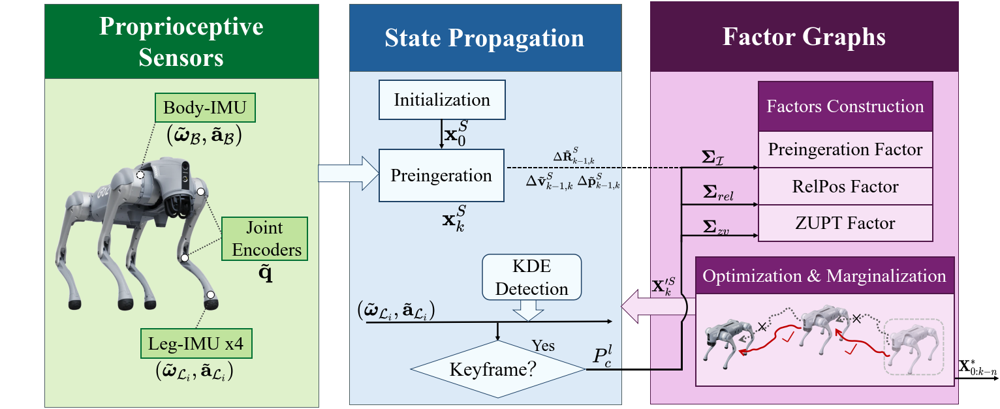

# LAG-IO
[Paper (arXiv)](coming soon) · [Dataset](https://drive.google.com/drive/folders/1-oUQhmWwudjDG4DhdiOnmrlgEyQkSMgb?usp=sharing)


**Multi-IMU State Estimation for Legged Robots Using Factor Graphs**


LAG-IO using a factor graph-based multi-IMU state estimation framework that tightly couples measurements from a
main body IMU, multiple leg-mounted IMUs, and joint encoders within a sliding-window optimization. 




## Build

```bash
sudo apt install build-essential cmake libboost-all-dev
cmake -S . -B build -DCMAKE_BUILD_TYPE=Release
cmake --build build -j2
```

Requires C++17. GTSAM, yaml-cpp, and Abseil are bundled.

## Dataset

**Download:** 
[Dataset]([DATASET_DOWNLOAD_URL](https://drive.google.com/drive/folders/1-oUQhmWwudjDG4DhdiOnmrlgEyQkSMgb?usp=sharing))

Extract the dataset into the repository root, preserving this layout:

```text
data/
├── 20250211/       # asphalt road
├── 20250218-1/     # Parkinglots
├── 20250218-2/     # Grass
└── 20250219/       # Construction site and Offroad
```

Each recording contains `FL/`, `FR/`, `RL/`, `RR/`, `gins/`, and `robot/`. File names and formats are described in [data_format](docs/data-format.md). 

## Run

```bash
./build/lag_io config/Parkinglots.yaml
./build/lag_io "config/asphalt road.yaml"
./build/lag_io config/Grass.yaml
./build/lag_io "config/Construction site.yaml"
./build/lag_io config/Offroad.yaml
```

All sequences share `config/estimator.yaml`. Results are written to `output/<sequence>/`.

## Plot

```bash
pip install -r scripts/requirements.txt
python3 scripts/plot_trajectory.py output/Parkinglots/Body_traj.txt \
  --gt data/20250218-1/gins/gt_tum_20250218-1.txt \
  --sync --origin --swap-xy --title Parkinglots \
  --output output/Parkinglots/trajectory.png
```

Omit `--gt` and `--sync` for Grass, whose processed GT is unavailable. Add `--3d` for a spatial plot.

## Citation

```bibtex
@inproceedings{zhou2026lagio,
  title     = {LAG-IO: Multi-IMU State Estimation for Legged Robots Using Factor Graphs},
  author    = {Yicheng Zhou and Longwen Chen and Qinghua Yu and Junhao Xiao and Huimin Lu and Xieyuanli Chen},
  booktitle = {IEEE/RSJ International Conference on Intelligent Robots and Systems (IROS)},
  year      = {2026}
}
```

## Contact

Yicheng Zhou — `yczhou@nudt.edu.cn`